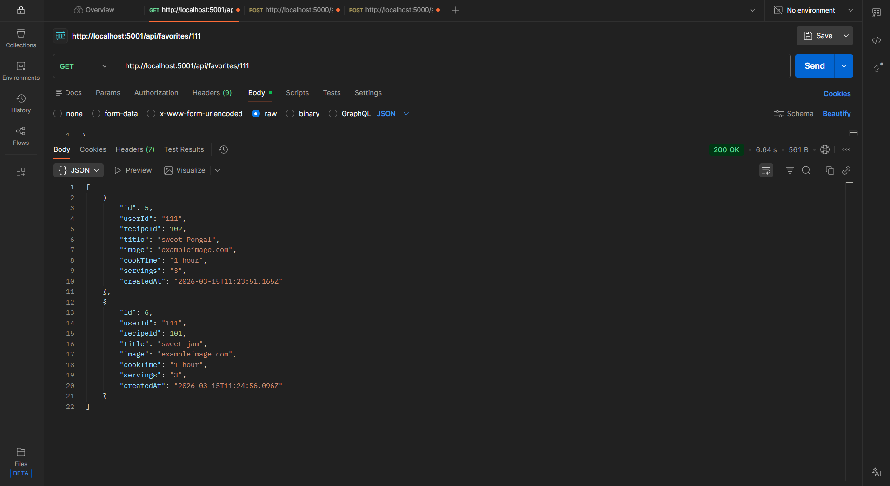
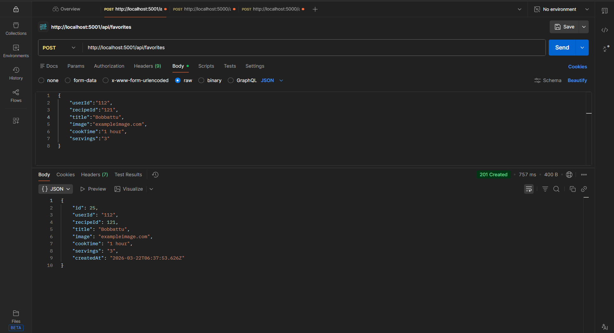
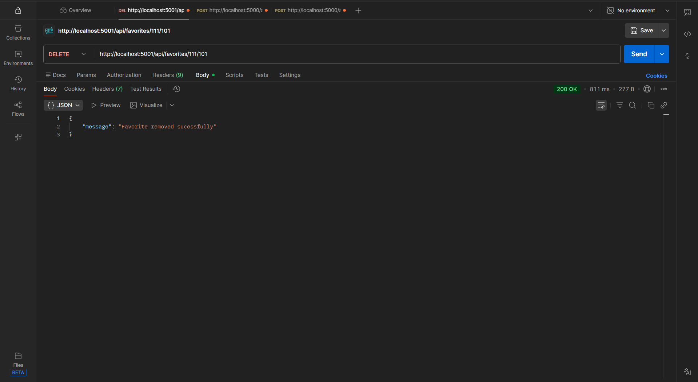
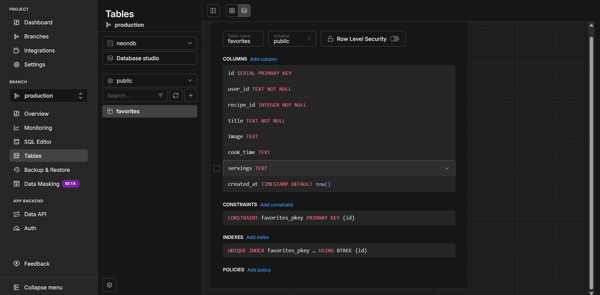
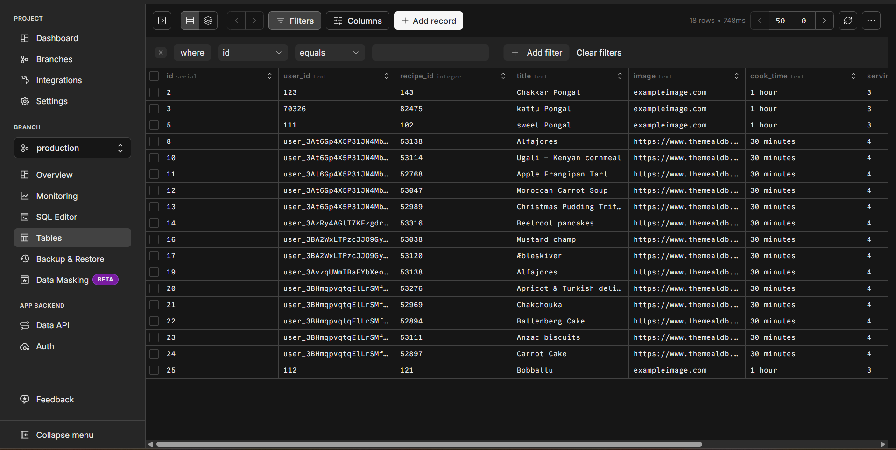

<div align="center">

# 🍽️ Recipe Finder API

### REST API backend for the Recipe Finder mobile application

[](https://nodejs.org/)
[](https://expressjs.com/)
[](https://www.postgresql.org/)

 • [👨‍💻 GitHub](https://github.com/chaitanya-krishna/recipie-app-backend)

</div>

---

## 📸 Screenshots

<div align="center">
<table>
  <tr>
    <td align="center"></td>
    <td align="center"></td>
    <td align="center"></td>
  </tr>
  <tr>
    <td align="center"></td>
    <td align="center"></td>
  </tr>
</table>
</div>

---

## 📖 About

Recipe Finder API is the backend REST API for the Recipe Finder application. It handles user favorites — storing, fetching, and deleting recipes that users save. It is built with Node.js and Express, uses PostgreSQL hosted on Neon, and is deployed on Render.

The frontend application is planned and will be developed in the future.

---

## ✨ Features

- 🔐 **User Favorites** — Save and manage favorite recipes per user
- 🗄️ **PostgreSQL Database** — Cloud-hosted on Neon
- 🚀 **Render Deployment** — Hosted REST API
- ⚡ **Fast & Lightweight** — Minimal Express server
- 🔄 **CORS Enabled** — Supports requests from client applications
- 💓 **Health Check** — Check API status

---

## 🛠️ Tech Stack

| Technology | Purpose |
|------------|---------|
| Node.js | Runtime environment |
| Express.js | Web framework |
| Neon PostgreSQL | Cloud database |
| Drizzle ORM | Database queries and schema management |
| Render | Cloud deployment |

---

## 📁 Project Structure

```text
recipe-app-api/
├── screenshots/                 # API testing screenshots
├── src/
│   ├── config/
│   │   ├── db.js                 # Database connection
│   │   └── env.js                # Environment variables
│   ├── db/
│   │   ├── migrations/           # Database migrations
│   │   └── schema.js             # Database schema
│   └── server.js                 # Express server and API routes
├── .gitignore
├── drizzle.config.js             # Drizzle ORM configuration
├── package.json
└── package-lock.json
```

> The `.env` file is intentionally excluded from version control. Create your own local `.env` file using the instructions below.

---

## 🗄️ Database Schema

The `favorites` table stores recipes saved by users.

| Column | Type | Constraints / Description |
|--------|------|---------------------------|
| `id` | serial | Primary key |
| `user_id` | text | Not null; user identifier |
| `recipe_id` | integer | Not null; recipe identifier |
| `title` | text | Not null; recipe name |
| `image` | text | Recipe image URL |
| `cook_time` | text | Cooking time |
| `servings` | text | Number of servings |
| `created_at` | timestamp | Defaults to the current timestamp |

---

## 🌐 API Reference

**Base URL**

```text
https://recipe-app-api-ot01.onrender.com
```

### Health Check

```http
GET /api/health
```

**Response**

```json
{
  "success": true
}
```

---

### Get User Favorites

```http
GET /api/favorites/:userId
```

**Path parameters**

| Parameter | Type | Description |
|-----------|------|-------------|
| userId | string | User identifier |

**Example response**

```json
[
  {
    "id": 1,
    "userId": "user_abc123",
    "recipeId": 52772,
    "title": "Chicken Tikka Masala",
    "image": "https://www.themealdb.com/images/...",
    "cookTime": "30 minutes",
    "servings": "4",
    "createdAt": "2026-03-15T11:05:39.324Z"
  }
]
```

---

### Add to Favorites

```http
POST /api/favorites
```

**Request body**

```json
{
  "userId": "user_abc123",
  "recipeId": 52772,
  "title": "Chicken Tikka Masala",
  "image": "https://www.themealdb.com/images/...",
  "cookTime": "30 minutes",
  "servings": "4"
}
```

**Example response**

```json
{
  "id": 1,
  "userId": "user_abc123",
  "recipeId": 52772,
  "title": "Chicken Tikka Masala",
  "image": "https://www.themealdb.com/images/...",
  "cookTime": "30 minutes",
  "servings": "4",
  "createdAt": "2026-03-15T11:05:39.324Z"
}
```

---

### Remove from Favorites

```http
DELETE /api/favorites/:userId/:recipeId
```

**Path parameters**

| Parameter | Type | Description |
|-----------|------|-------------|
| userId | string | User identifier |
| recipeId | integer | Recipe identifier |

**Response**

```json
{
  "message": "Favorite removed successfully"
}
```

---

## 🚀 Getting Started

### Prerequisites

- Node.js 18 or later
- A Neon PostgreSQL account
- npm

### Installation

**1. Clone the repository**

```bash
git clone https://github.com/chaitanya-krishna/recipie-app-backend.git
cd recipie-app-backend
```

**2. Install dependencies**

```bash
npm install
```

**3. Create a `.env` file in the project root**

```env
DATABASE_URL=your_neon_postgresql_connection_string
PORT=5001
NODE_ENV=development
```

Do not commit your `.env` file or share your database connection string.

**4. Start the development server**

```bash
npm run dev
```

The API will run at:

```text
http://localhost:5001
```

---

## 🌍 Deployment

The API is planned to hosted on **Render** and uses a Neon PostgreSQL database.(will available in future)

```text
Platform: Render
Service:  Web Service
Runtime:  Node.js
Database: Neon PostgreSQL
```

---

## 🔗 Frontend Application

The frontend application for Recipe Finder is planned for future development. Its repository and integration details will be added here once the frontend is built.

---

## 👨‍💻 Developer

**Chaitanya Krishna**

[](https://github.com/chaitanya-krishna)

---

## 📄 License

This project is open source and available under the [MIT License](LICENSE).

---

<div align="center">

Made with ❤️ by **Chaitanya Krishna**

⭐ Star this repository if you find it helpful!

</div>